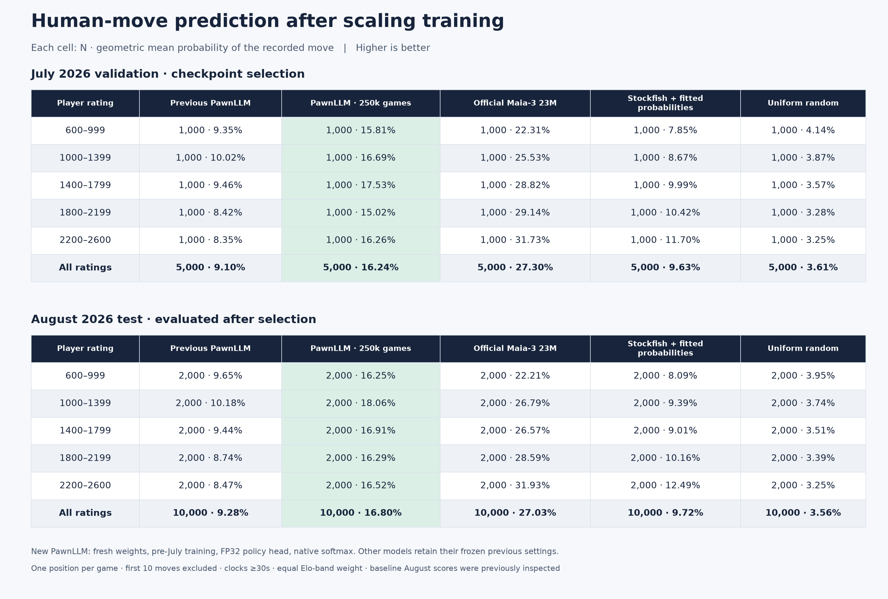
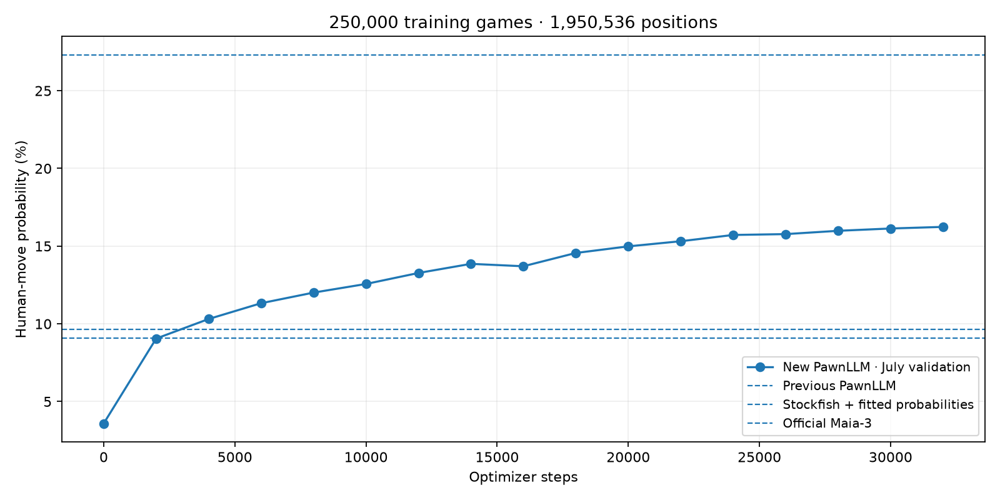

# Scaling human-move prediction

## Completed results

The new model improves August human-move probability from **9.28% to 16.80%**.
Maia remains substantially ahead. Scores are geometric mean probabilities of the
recorded human move, with equal weight for each Elo band; they are not exact-move
accuracy. Each cell contains N and score.

| Model | July validation | August test |
| --- | ---: | ---: |
| Previous PawnLLM | 5,000 · 9.10% | 10,000 · 9.28% |
| PawnLLM, 250k games | 5,000 · 16.24% | 10,000 · 16.80% |
| Official Maia-3 23M | 5,000 · 27.30% | 10,000 · 27.03% |
| Stockfish + fitted probabilities | 5,000 · 9.63% | 10,000 · 9.72% |
| Uniform random | 5,000 · 3.61% | 10,000 · 3.56% |

The new model's August 95% whole-game bootstrap interval is
**16.33%–17.27%**. The checkpoint was selected at step 32,000
using July only; its August score was then evaluated once. New PawnLLM uses native
softmax with no calibration fit. Historical baselines retain their old calibration
and settings. See [the full results](holdout-metadata/scaling-250k-scores.json).





The training loop took **960.6 seconds (16.0 minutes)**. Peak PyTorch GPU allocation
was **2.105 GiB** (2.172 GiB reserved); maximum sampled trainer/loader host PSS was
**2.146 GiB**. These are process measurements, not total-machine memory peaks.
All 35 unit tests passed, along with JavaScript syntax and live HTTP checks.

Replacing both player ratings with 1500 raises July policy NLL from 1.81774 to
1.84277, showing a modest benefit from the learned rating inputs. This is an
inference ablation, not proof of precise human fidelity at every requested Elo.

### Analysis UI

The server uses `runs/chess-human-250k/best.pt` from move 11 onward. The new training
set excludes opening positions; starting-board checks showed weaker opening
suggestions. The UI therefore retains `runs/chess-human-calibrated/best.pt` for
positions before 20 half-moves, including continuations requested from those
positions. `--opening-checkpoint` can override that opening model. Reported temporal
scores concern only the new model after the opening, not this combined UI behavior.
The opening fallback retains the old pilot's training provenance.

The live server binds to **0.0.0.0:8000**. HTTP checks covered Elo 600/2600,
three-ply continuations, the opening-model boundary, normalized outcome scores,
and preserving exactly the user-supplied moves for both colors.

## Precision fix

The existing policy head computes dot products with a large common offset
(about −161 in an initial diagnostic). BF16 rounding loses differences between
legal moves. In a 128-position July validation batch, only 21.2% of legal scores
were distinct at the median position; full FP32 inference preserved all of them.

Keeping only the policy projections, dot products and promotion scores in FP32
improved the existing, uncalibrated model on all 5,000 July validation positions:

| Policy computation | Human-move probability | Macro NLL |
| --- | ---: | ---: |
| Legacy BF16 | 8.81% | 2.42877 |
| FP32 policy head | 9.27% | 2.37863 |

These are native softmax probabilities with no temperature fit. The previous
served checkpoint scored 9.10% with its old calibration. The controlled precision
comparison above uses identical weights and no calibration in either row.
The transformer remains in BF16. Legacy checkpoints retain their old behavior;
new runs opt in with `--fp32-policy` and save that setting in the checkpoint.

Reproduce the precision audit:

```sh
uv run python scripts/audit_policy_precision.py \
  --checkpoint runs/chess-human-refined/best.pt \
  --data /mnt/archive/lichess/temporal-holdout-2026 \
  --output runs/chess-scaling/precision-reproduction.json
```

## Training experiment

The completed set contains **250,000 games / 1,950,536 positions**, stored in
164 MB of compressed shards and metadata. All shards passed verification; game
IDs are unique, train-only by hash, and disjoint from the reserved holdouts.
See the [manifest](holdout-metadata/training-250k-manifest.json) and
[verification](holdout-metadata/training-250k-verification.json).

Prepare 250,000 training games from the existing all-rating archive, using only
monthly files before July 2026. No additional download is needed. Keep the old
hash-based validation/test games excluded as well as the 15,000 reserved temporal
games. Write accepted IDs to `games.jsonl` for an explicit overlap audit.

Sample up to eight positions per game after the first 20 half-moves. Balance five
bands of mean player rating, 50,000 games each. Both players must be 600–2600;
games must be blitz, have a known result, and terminate normally. The original TSV
archive has no move clocks: training cannot apply the holdouts' 30-second clock
filter. Sampling interleaves monthly prefixes and is not uniform over all games.

```sh
uv run python -m pawnllm.chess_data \
  --source /mnt/archive/lichess/elo-conditioned \
  --output /mnt/archive/lichess/chess-human-250k \
  --games 250000 --max-scan 100000000 --positions-per-game 8 \
  --min-ply 20 --min-elo 600 --speeds blitz --rating-conditioned \
  --train-only --before-month 2026-07 \
  --exclude-games /mnt/archive/lichess/temporal-holdout-2026/games.json

uv run python scripts/verify_chess_training.py \
  --data /mnt/archive/lichess/chess-human-250k

uv run python -m pawnllm.chess_train \
  --data /mnt/archive/lichess/chess-human-250k \
  --validation-data /mnt/archive/lichess/temporal-holdout-2026 \
  --model human --fp32-policy --output runs/chess-human-250k \
  --steps 32000 --batch-size 128 --workers 2 \
  --lr 0.0003 --warmup 250 --schedule cosine \
  --eval-every 2000 --log-every 250
```

Train the same 22,810,439-parameter architecture from scratch. The old weights
included some July games, so reusing them would weaken a strict temporal split.
AdamW uses 250 warmup steps, then cosine decay to 10% of the peak learning rate.
The 32,000-step budget covers roughly two passes over the prepared positions.
The value objective remains game outcome with weight 0.5 alongside human-move CE.

Select the checkpoint with the lowest equal-weight Elo-band policy NLL on all
5,000 July validation positions. Evaluate August only after this selection;
the earlier baseline scores have already been inspected, so August is not an
untouched confirmatory set. Other models retain their frozen previous scores.

```sh
uv run python scripts/compare_scaled_chess.py \
  --checkpoint runs/chess-human-250k/best.pt \
  --output runs/chess-scaling/comparison-250k
```

The trainer also supports `--init-from` for weights-only transfer to another data
manifest, while `--resume` preserves the optimizer and requires matching training
and validation manifests. Preparation and loading stream compact shards; training
logs sampled host PSS and CUDA allocation to check the 32 GB RAM / 24 GB GPU limits.
