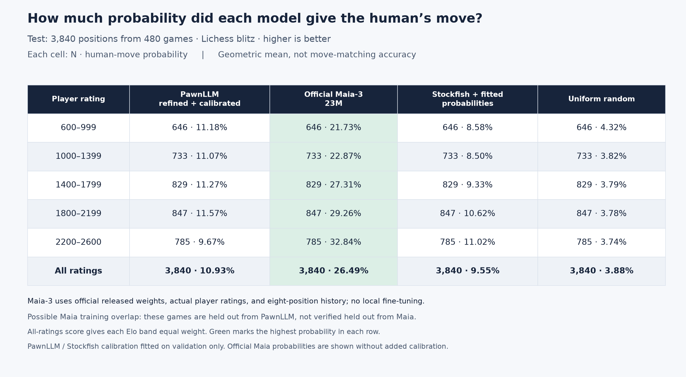

# Human-move probability, including official Maia-3

This table replaces top-three agreement with **geometric mean probability assigned
to the recorded human move**. It is `exp(-NLL)`, using natural-log loss and giving
each rating band equal weight in the overall row. Higher is better. This is not
the percentage of moves guessed correctly, nor the arithmetic mean probability.

## Official model

We evaluated the released [Maia-3 23M model](https://huggingface.co/UofTCSSLab/Maia3-23M)
using the [official CSSLab inference code](https://github.com/CSSLab/maia3).
The actual parameter count is 22,936,580, close to PawnLLM's 22,810,439.
No local fine-tuning or added calibration is applied in the official-model column.
All 4,016 validation and 3,840 test positions were evaluated, with actual active and
opponent ratings and real eight-position history. No positions were dropped.

The official tokenizer is used verbatim: chronological snapshots, earliest-position
padding, each board tokenized from its own active player's perspective. The official
preset excludes clock inputs; its unused ponder feature is zero, matching the UCI
implementation. Move probabilities use temperature one and normalize over every legal
move, including promotions. All checkpoint tensors loaded strictly; inference used
float32 without autocast and batches of 128 on the RTX 4090.

**Possible training overlap:** the games are held out from PawnLLM, but have not been
verified absent from Maia's training corpus. The models also have very different
training-data budgets. These results compare these checkpoints on our pilot positions;
they are not a reproduction of Maia's published benchmark or a controlled architecture
comparison.

## Test table



Each cell is **N · geometric mean human-move probability**.

| Player rating | PawnLLM (refined + calibrated) | Official Maia-3 23M | Stockfish + fitted probabilities | Uniform random |
| --- | ---: | ---: | ---: | ---: |
| 600-999 | 646 · 11.18% | 646 · 21.73% | 646 · 8.58% | 646 · 4.32% |
| 1000-1399 | 733 · 11.07% | 733 · 22.87% | 733 · 8.50% | 733 · 3.82% |
| 1400-1799 | 829 · 11.27% | 829 · 27.31% | 829 · 9.33% | 829 · 3.79% |
| 1800-2199 | 847 · 11.57% | 847 · 29.26% | 847 · 10.62% | 847 · 3.78% |
| 2200-2600 | 785 · 9.67% | 785 · 32.84% | 785 · 11.02% | 785 · 3.74% |
| Overall | 3,840 · 10.93% | 3,840 · 26.49% | 3,840 · 9.55% | 3,840 · 3.88% |

Maia is ahead in every rating band. Its overall score is **26.49%**, versus **10.93%**
for refined PawnLLM and **9.55%** for the fitted Stockfish baseline. The paired-game
inputs are identical. Maia's 95% game-cluster bootstrap interval is **25.39–27.62%**,
conditional on the fixed checkpoint and this sample; it does not address training overlap.
After excluding the first 20 half-moves, Maia's equal-band probability is **29.41%**.

As a supplementary check, applying the same validation-only temperature/tail fitting
used for PawnLLM and Stockfish yields **26.45%** for Maia on test. Both raw and fitted
results are saved; the main table shows the unmodified official model as requested.

## Validation table

Validation was used to fit PawnLLM and Stockfish calibration, so those columns are
fitted estimates. The official Maia column remains raw.

| Player rating | PawnLLM (refined + calibrated) | Official Maia-3 23M | Stockfish + fitted probabilities | Uniform random |
| --- | ---: | ---: | ---: | ---: |
| 600-999 | 848 · 10.85% | 848 · 18.97% | 848 · 7.54% | 848 · 4.03% |
| 1000-1399 | 800 · 11.59% | 800 · 23.27% | 800 · 8.52% | 800 · 3.77% |
| 1400-1799 | 880 · 12.49% | 880 · 27.36% | 880 · 9.77% | 880 · 3.83% |
| 1800-2199 | 901 · 12.95% | 901 · 31.44% | 901 · 10.44% | 901 · 3.82% |
| 2200-2600 | 587 · 10.80% | 587 · 34.14% | 587 · 12.84% | 587 · 3.57% |
| Overall | 4,016 · 11.70% | 4,016 · 26.46% | 4,016 · 9.66% | 4,016 · 3.80% |

## Verification and provenance

- Official source commit: `1e13597c42d4858b7cfd7cfdae01e297263364b2`.
- Checkpoint SHA-256: `bce6cd1af5f0399ac7eed33fabb7a6a2ef6193662c2740f262bf93af7bfb3569`.
- Position-file SHA-256: `a49e7693bb4f26f7f08c0f81d848edfaf5fd4cf2cc7bf2855e8b79783c4f5b2a`.
- Every row was matched to stored rating, target action and ply; every reconstructed
  FEN matched; official legal-move coverage was checked for every position.
- Saved batched probabilities were cross-checked against the official position-wise
  UCI implementation on Black-to-move, White-to-move, early-history and promotion
  examples. The UCI API exposes up to 20 candidates; their probabilities agree to
  `rtol=2e-4, atol=2e-6` with our full-legal-distribution evaluation.
- Maia extraction plus calibration completed in about 9.9 seconds.

## Reproduce

```sh
git clone https://github.com/CSSLab/maia3.git runs/maia3-official
git -C runs/maia3-official checkout 1e13597c42d4858b7cfd7cfdae01e297263364b2
uv run python -m pawnllm.maia_benchmark
uv run python scripts/verify_maia_adapter.py
uv run --with matplotlib python scripts/render_human_probability.py
```

The official model is downloaded into `runs/maia3-cache`. Core dependencies already
exist in this worktree's environment; no official code is vendored into the package.
Generated outputs:

- `runs/maia3-comparison/summary.json`: provenance, per-split/per-band scores, calibration check.
- `runs/maia3-comparison/scores.npz`: every legal score, target, ratings and split masks.
- `runs/human-comparison/human-move-probability.json`: numeric rendered table.
- `runs/human-comparison/human-move-probability.png` and `.pdf`: test table.
- `runs/human-comparison/human-move-probability-validation.png` and `.pdf`: validation table.

The prior [probability comparison](human-probability-comparison.md) documents PawnLLM
fine-tuning, Stockfish's 100k-node all-legal search, and dataset limitations. Its raw
artifacts remain available for reproduction.
