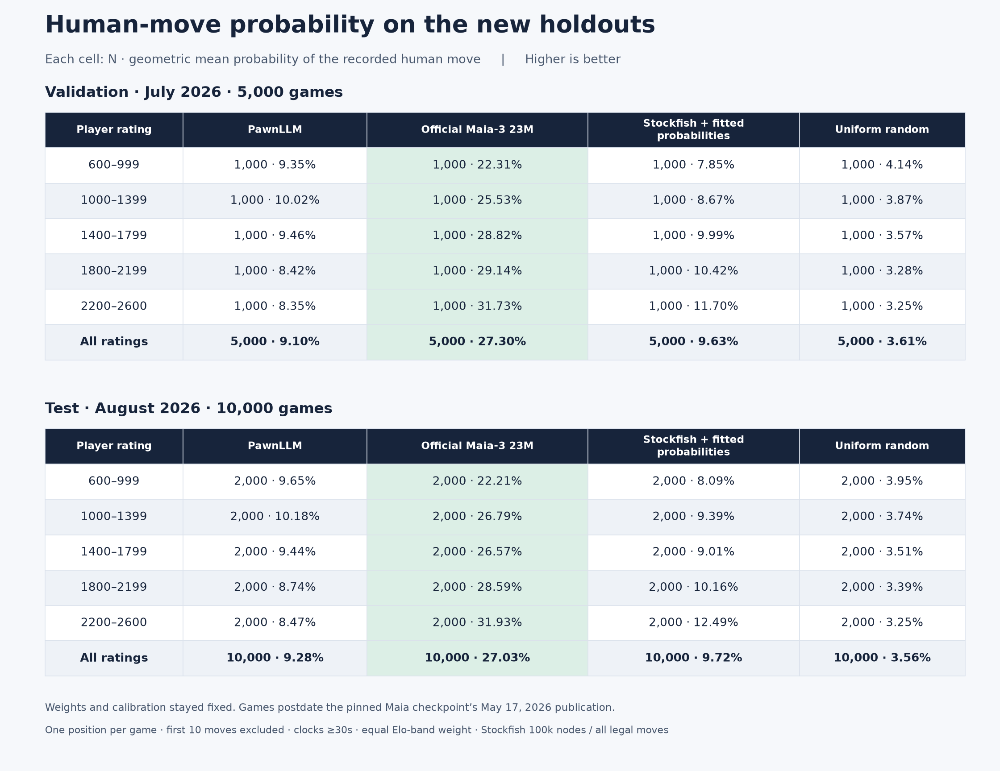

# Current models on the temporal holdout

These are the first requested current-model scores on the July/August 2026 holdouts.
No weights or calibration parameters were fitted on either new split. The test
results are now inspected; keep the dataset fixed and never train or calibrate on test.

**Metric:** geometric mean probability assigned to the recorded human move,
`exp(-NLL)`. Higher is better. The overall score gives each Elo band equal weight.
Each game contributes one position. This is not move-matching accuracy.



## Overall results

| Split | N | PawnLLM | Official Maia-3 23M | Stockfish + fitted probabilities | Uniform random |
| --- | ---: | ---: | ---: | ---: | ---: |
| July validation | 5,000 | 9.10% | 27.30% | 9.63% | 3.61% |
| August test | 10,000 | 9.28% | 27.03% | 9.72% | 3.56% |

Maia's advantage persists on games played after the pinned checkpoint was public.
This rules out those particular later games being training examples for that checkpoint;
it does not rule out recurring positions or players. Model size is similar, but training
data, training compute, architecture details, and preprocessing differ.

## Per-Elo results

Cells contain **N · human-move probability**.

### July validation

| Rating | PawnLLM | Maia-3 | Stockfish + fitted probabilities | Random |
| --- | ---: | ---: | ---: | ---: |
| 600-999 | 1,000 · 9.35% | 1,000 · 22.31% | 1,000 · 7.85% | 1,000 · 4.14% |
| 1000-1399 | 1,000 · 10.02% | 1,000 · 25.53% | 1,000 · 8.67% | 1,000 · 3.87% |
| 1400-1799 | 1,000 · 9.46% | 1,000 · 28.82% | 1,000 · 9.99% | 1,000 · 3.57% |
| 1800-2199 | 1,000 · 8.42% | 1,000 · 29.14% | 1,000 · 10.42% | 1,000 · 3.28% |
| 2200-2600 | 1,000 · 8.35% | 1,000 · 31.73% | 1,000 · 11.70% | 1,000 · 3.25% |

### August test

| Rating | PawnLLM | Maia-3 | Stockfish + fitted probabilities | Random |
| --- | ---: | ---: | ---: | ---: |
| 600-999 | 2,000 · 9.65% | 2,000 · 22.21% | 2,000 · 8.09% | 2,000 · 3.95% |
| 1000-1399 | 2,000 · 10.18% | 2,000 · 26.79% | 2,000 · 9.39% | 2,000 · 3.74% |
| 1400-1799 | 2,000 · 9.44% | 2,000 · 26.57% | 2,000 · 9.01% | 2,000 · 3.51% |
| 1800-2199 | 2,000 · 8.74% | 2,000 · 28.59% | 2,000 · 10.16% | 2,000 · 3.39% |
| 2200-2600 | 2,000 · 8.47% | 2,000 · 31.93% | 2,000 · 12.49% | 2,000 · 3.25% |

## August uncertainty

95% intervals use 2,000 whole-game bootstrap resamples, with fixed weights and
calibration. Games, not multiple positions from one game, are resampled.

| Model | Probability | 95% interval |
| --- | ---: | ---: |
| pawnllm | 9.28% | 9.01%–9.55% |
| maia3 | 27.03% | 26.37%–27.68% |
| stockfish | 9.72% | 9.42%–10.05% |
| random | 3.56% | 3.51%–3.61% |

## Frozen systems and audit

- PawnLLM: current refined step-5500 weights and the embedded original-validation
  calibration from `runs/chess-human-calibrated/best.pt`. It still uses only the
  24,018-game / 192,144-position training pilot. No larger training run has occurred.
- Maia: official 23M weights pinned to the May 17, 2026 upload revision
  `6975c77af86aa3f6c95d54a8da4e83e12119a4de`, verified against the holdout's publication
  SHA-256. Native probabilities, actual ratings, eight-position history, float32.
- Stockfish 19: 100,000 total nodes per position, every legal move scored, one thread
  and 64 MiB hash per worker, fresh game/hash each position, four workers. Its
  temperature/uniform-tail probability mapping is copied from the earlier pilot
  validation calibration, not refitted on July or August.
- Uniform random: equal probability over legal moves at each position.
- All 15,000 positions match the verified dataset manifest and position-file hash.
  PawnLLM/Maia target indices, legal-move masks, Elo bands, and game order agree;
  Stockfish covers exactly the same positions and legal moves with matching targets.
- The 32-test suite passes. No model or data changed based on these results.

The [dataset report](temporal-holdout.md) documents clock/opening filters, source
chunk sampling, reserved game IDs, and date provenance. Its immutable manifest records
creation-time status; this evaluation is recorded separately. These results should
not be directly compared with the earlier opening-inclusive, multi-position-per-game
pilot as if only contamination status changed.

## Reproduce

Use a fresh Stockfish output directory when repeating its search. Defaults in
`temporal_scores` point to `runs/temporal-scores` and the frozen temporal dataset.

```sh
uv run python -m pawnllm.stockfish_benchmark run \
  --positions /mnt/archive/lichess/temporal-holdout-2026/positions.jsonl \
  --engine runs/stockfish/bin/stockfish/stockfish-linux-x86-64-universal \
  --output runs/temporal-scores/stockfish --nodes 100000 --workers 4 --all-legal

uv run python -m pawnllm.maia_benchmark \
  --data /mnt/archive/lichess/temporal-holdout-2026 \
  --positions /mnt/archive/lichess/temporal-holdout-2026/positions.jsonl \
  --output runs/temporal-scores/maia \
  --revision 6975c77af86aa3f6c95d54a8da4e83e12119a4de --no-calibration

uv run python -m pawnllm.temporal_scores extract
uv run python -m pawnllm.temporal_scores report
uv run --with matplotlib python scripts/render_temporal_scores.py
```

Local artifacts: `runs/temporal-scores/summary.json` (metrics and provenance),
`per-position-losses.npz`, `pawn.npz`, `maia/scores.npz`, `stockfish/results.jsonl`,
and `comparison.png` / `comparison.pdf`. The report includes checkpoint, calibration,
source-position and dataset-manifest hashes. [Saved summary](holdout-metadata/temporal-scores.json).
